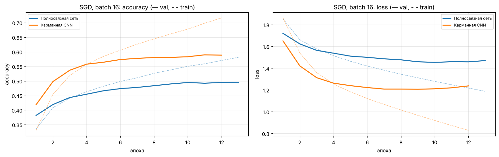
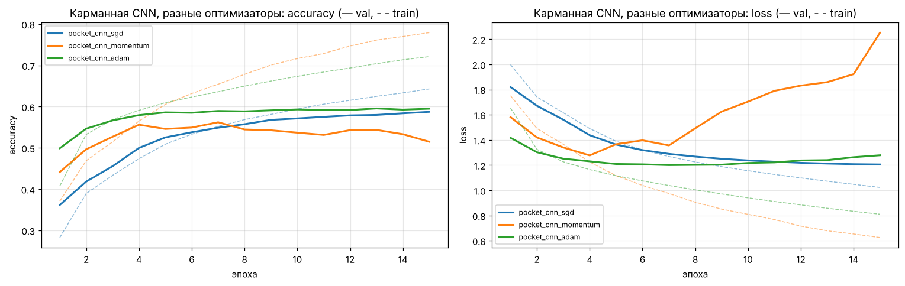
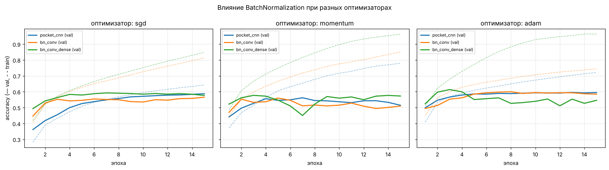
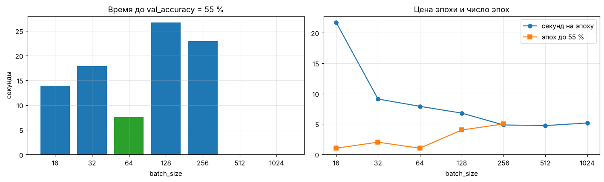
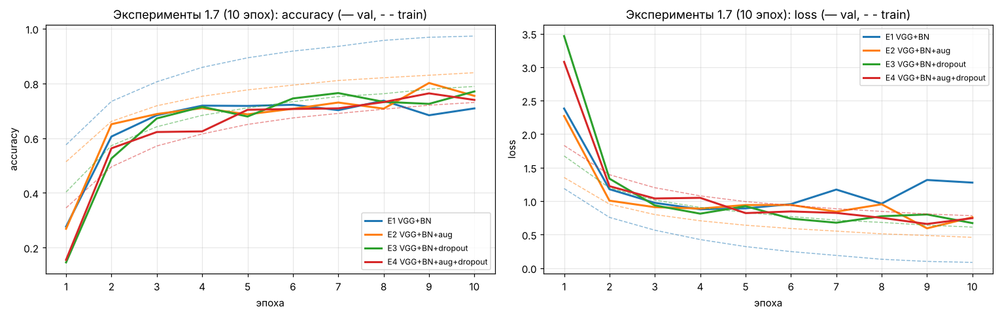
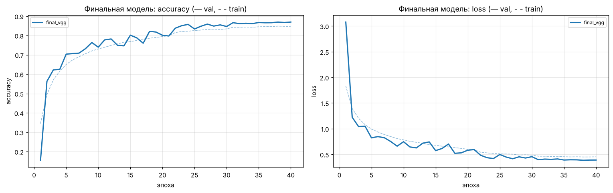
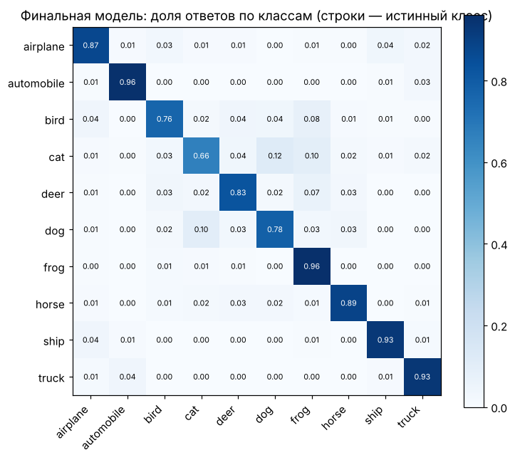

# Свёрточные нейронные сети: классификация CIFAR-10

Домашнее задание к занятию «Введение в свёрточные НС».

**Автор:** Александра Бужор · Telegram [@Angry_C_F_O](https://t.me/Angry_C_F_O)

[](https://colab.research.google.com/github/AngryAlexQA/SvertNS/blob/main/Intro_to_NN_3_hw.ipynb)

## Результат

| Задание | Модель | Accuracy на тесте | Порог |
|---|---|---|---|
| 1.1 | Полносвязная сеть (Flatten → 512 → 256 → 10), SGD | 49,37 % | 45 % ✅ |
| 1.2 | «Карманная» CNN (Conv 3×3 ×10 → MaxPool → Dense 100), SGD | 58,63 % | 50 % ✅ |
| 1.7 | VGG-подобная CNN + BatchNorm + аугментация + Dropout | **85,76 %** | 80 % ✅ |
| 1.7 | то же + TTA (оригинал + отражение) | **86,43 %** | — |

Выполнены все задания, включая опциональные 1.3–1.6. Ноутбук выполнен целиком: все выводы, графики и цифры в комментариях — результаты одного прогона.

## Содержимое

| Файл | Что внутри |
|---|---|
| [`Intro_to_NN_3_hw.ipynb`](Intro_to_NN_3_hw.ipynb) | Решение с выводами ячеек и комментариями к каждому заданию |
| [`images/`](images) | Кривые обучения и графики, сохранённые ноутбуком |
| [`requirements.txt`](requirements.txt) | Зависимости для локального запуска |

## Кратко по заданиям

**1.1–1.2. Полносвязная сеть против свёрточной.** Карманная CNN в 7,5 раза меньше по числу параметров (226 тыс. против 1,71 млн), но точнее на 9,3 п.п.: свёртка использует пространственную структуру изображения.



**1.3. Оптимизаторы (параметры по умолчанию).** Лучший — Adam: 55 % на валидации за 3 эпохи и самая высокая кривая. SGD устойчив, но медленный. Momentum при lr = 0,01 быстро стартует и так же быстро переобучается.



**1.4. BatchNormalization.** Ускоряет обучение (с SGD 55 % за 3 эпохи вместо 8) и даёт лучший пик сетки — 0,614 у BN в свёртке и Dense с Adam. Но без регуляризации вместе с обучением ускоряется и переобучение.



**1.5. batch_size.** На CPU быстрее всего до 55 % доходит батч 64 (7,5 с). При 512 и 1024 сеть делает слишком мало шагов за эпоху и до цели не доходит.



**1.6. Лучшая кривая обучения.** Критерии: быстрый рост, высокое плато и отсутствие переобучения; основная метрика — средняя `val_accuracy` по эпохам (площадь под кривой). При фиксированном бюджете лучший Adam (без BN или с BN в свёртке), при ранней остановке — Adam + BN в свёртке и Dense.

**1.7. Большая сеть.** Эксперименты по правилу «одно изменение за раз»: глубина и ширина дали +14 п.п. на валидации, аугментация — ещё +6,5 п.п. и втрое меньший разрыв train − val, dropout убирает переобучение. Финальная модель (552 тыс. параметров) обучена 40 эпох со снижением learning rate на плато.




Труднее всего сети даются кошки (66 %, чаще всего путаются с собаками), птицы и собаки; лучше всего — лягушки и автомобили (96 %).



## Что исправлено в заготовке

* Полносвязная сеть: `Dense` стоял до `Flatten` — порядок приведён к условию.
* `validation_split=0.2` заменён на уже отложенную валидацию `X_val`.
* В 1.7 `split = 45000` давал пустую валидацию (в `X_train` после разбиения 40 000 картинок) — используется `X_val`.
* Совместимость с Keras 3: чекпойнты в формате `.keras`, `fit` вместо удалённого `fit_generator`, отдельный экземпляр оптимизатора на каждую модель в `Evaluator`, аугментация слоями Keras вместо устаревшего `ImageDataGenerator`.
* `Evaluator` сохраняет истории обучения для кривых; `Models.add` не используется, потому что делит один объект слоя (и его веса) между моделями.

## Как запустить

**Google Colab:** нажать на значок «Open in Colab» выше, выбрать среду с GPU (*Среда выполнения → Сменить среду выполнения → T4 GPU*) и выполнить все ячейки. CIFAR-10 скачается автоматически.

**Локально (VS Code, Windows):** нужен Python **3.10–3.13** — для Python 3.14 TensorFlow пока не выпускается.

```powershell
py -3.13 -m venv .venv
.venv\Scripts\python -m pip install --upgrade pip
.venv\Scripts\python -m pip install -r requirements.txt
```

Затем открыть `Intro_to_NN_3_hw.ipynb` в VS Code (расширения Python и Jupyter), выбрать ядро `.venv` и нажать **Run All**. На macOS и Linux вместо `py -3.13` — `python3.13`, вместо `.venv\Scripts\python` — `.venv/bin/python`.

**Быстрая проверка:** скопировать ноутбук в `quick_check.ipynb` (он в `.gitignore`), во второй ячейке кода поставить `EPOCHS_STAND = 2`, `EPOCHS_EXP = 1`, `EPOCHS_FINAL = 2` и выполнить. Прогон займёт примерно полчаса вместо нескольких часов; пороги 1.1 и 1.2 проверяются так же, точность в 1.7 будет ниже 80 % — это ожидаемо.

Число эпох задаётся в начале ноутбука (`EPOCHS_STAND`, `EPOCHS_EXP`, `EPOCHS_FINAL`). Для большой сети в 1.7 автоматически включается смешанная точность: `mixed_float16` на GPU, `mixed_bfloat16` на CPU с поддержкой bfloat16, иначе обычный float32.

## Окружение прогона

TensorFlow 2.21, Keras 3.15, Python 3.13, CPU. Полный прогон занял около двух часов, из них 44 минуты — обучение финальной модели; на GPU — в разы быстрее.
